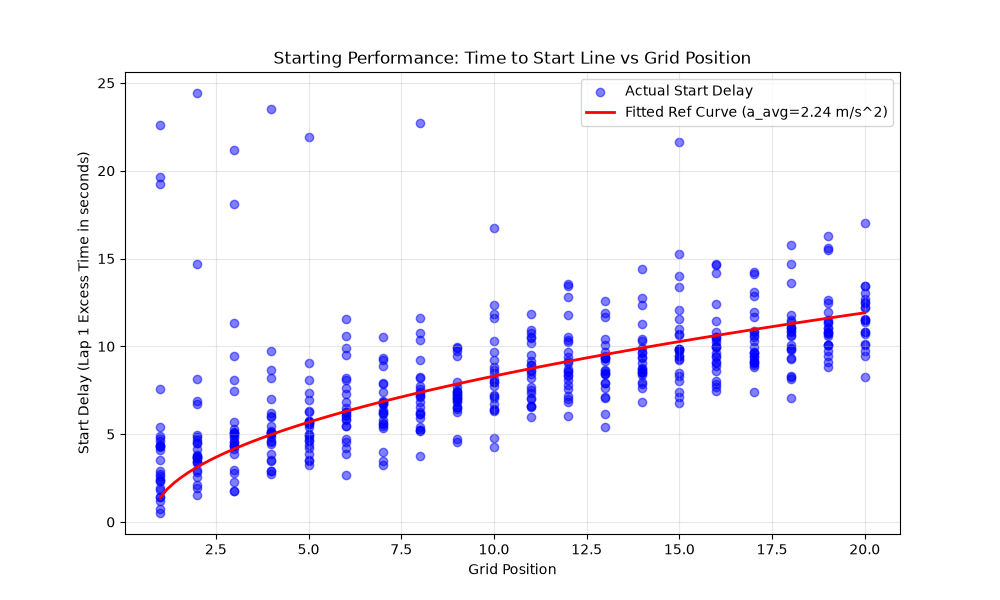
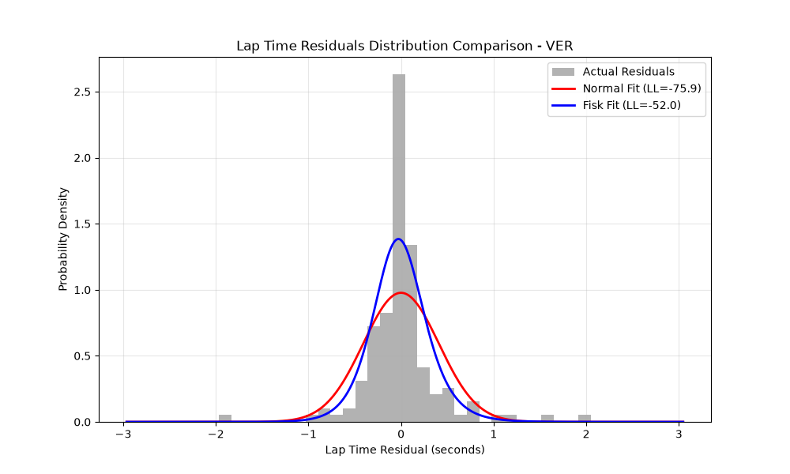

# F1 Race Strategy Optimizer

[](https://www.python.org/)
[](https://fastapi.tiangolo.com/)
[](https://react.dev/)
[](https://gymnasium.farama.org/)
[](https://docs.fastf1.dev/)

An end-to-end **Monte Carlo race simulation engine + Gymnasium RL environment + React 18 analytics dashboard** for Formula 1 race strategy optimization. Implements and extends the peer-reviewed methodology by **Heilmeier et al. (2020)** (*"Application of a Monte Carlo Simulation for Race Strategy Optimization in Formula 1"*).

> **Performance:** 500+ full-distance stochastic simulations (57 laps × 20 drivers) in **< 3.5 seconds** on a single CPU core.

---

## 🎯 Why This Project

Race strategy in F1 is a **stochastic optimal control problem** under uncertainty (tyre degradation, pit crew variance, Safety Cars, DNF risk). Most student projects stop at a static model. This project delivers:

1. **Research-grade simulation engine** — fitted empirical distributions from 2022–2025 FastF1 telemetry (tyre wear, pit stops, DNF, SC/VSC)
2. **Gymnasium RL environment** — `F1StrategyEnv` with 12D state space, 4 discrete actions, domain-informed reward shaping
3. **Production dashboard** — React 18 + WebSocket streaming, 20×20 position probability heatmap, RL vs. human strategy comparison
4. **Validated accuracy** — MAE ≈ 3.2 positions, 70% Top-10 precision/recall, 78% podium coverage across 9 historical GPs (2023–2024)

---

## ⚡ Key Components

### 1. Five-Factor Monte Carlo Engine (`src/race_simulator.py`)

| Factor | Model | Source |
|--------|-------|--------|
| **Standing Start** | Physical acceleration curve ($a_{\text{avg}} \approx 11.2\text{ m/s}^2$) + driver-specific Gaussian residuals $\mathcal{N}(\mu_i, \sigma_i^2)$ | FastF1 Lap 1 data |
| **Tyre Degradation** | State-space: $\alpha_t = \alpha_{t-1} + \nu_c + \eta_t$, $\eta_t \sim \mathcal{N}(0, \sigma_\eta^2)$ + Skew-Normal observation noise | FastF1 stint data per compound |
| **Pit Stop Duration** | Fisk (3-parameter log-logistic) $\mathcal{F}(c, \text{loc}, \text{scale})$ per team/circuit | FastF1 pit stop timing |
| **DNF Probability** | Bayesian Beta-Bernoulli: separate driver-accident vs. team-failure posteriors conditioned on circuit type (street/permanent/high-speed) | FastF1 race status + circuit classification |
| **FCY (SC/VSC)** | Empirical frequency, deployment lap bin (20% race-progress intervals), duration from Race Control messages | FastF1 session history |

**Core Lap Time Equation:**
$$t_{\text{lap}}(l) = \big(t_{\text{base}} + t_{\text{car},i} + t_{\text{driver},i} + t_{\text{fuel}}(l) + \alpha_l\big) \cdot M_{\text{SC}}(l) + t_{\text{var}}(l) + t_{\text{start}}(l) + t_{\text{pit}}(l) + t_{\text{DRS}}(l)$$

### 2. Reinforcement Learning Environment (`src/rl_environment.py`)

| Aspect | Specification |
|--------|---------------|
| **Interface** | Gymnasium `Env` — `reset()`, `step()`, `observation_space`, `action_space` |
| **State Space** | 12D continuous: race progress, tyre age, compound (one-hot), fuel mass, position, gap-to-leader, SC flag, latent wear, pit status, pit count |
| **Action Space** | 4 discrete: `0: STAY_OUT`, `1: PIT→SOFT`, `2: PIT→MEDIUM`, `3: PIT→HARD` |
| **Reward** | FIA points (25/18/15/12/10/8/6/4/2/1) + per-lap position-delta shaping + mandatory 2-compound regulation penalty + early-stint pit penalty |
| **Algorithm** | Tabular Q-Learning (extensible to DQN/PPO via Gymnasium API) |

### 3. React 18 Analytics Dashboard (`web/` / `frontend/`)

| Feature | Description |
|---------|-------------|
| **Strategy Editor** | Interactive pit-lap + compound selector with visual stint timeline bars |
| **Live WebSocket Streaming** | `/ws/simulate` streams batch completions every 5% with real-time probability matrix updates |
| **20×20 Position Heatmap** | Color-coded $P(\text{Driver}_i \text{ finishes } P_j)$ across all Monte Carlo runs |
| **RL vs. Human Comparison** | Side-by-side expected position ($\Delta \text{Pos}$), points ($\Delta \text{Pts}$), full distribution histograms |
| **Driver Deep-Dive** | Per-driver position distributions, P1/Podium/Points/DNF probabilities, compound wear curves |
| **Multi-GP Support** | 8 circuits: Bahrain, Saudi Arabia, Australia, Japan, Miami, Spain, Great Britain, Italy |

---

## 🏗️ System Architecture

```
┌─────────────────────────────────────────────────────────────────┐
│                    React 18 Dashboard (Vite)                    │
│  StrategyEditor │ PositionHeatmap │ RLComparison │ DriverDeepDive│
└────────────────────────────┬────────────────────────────────────┘
                             │ HTTP REST + WebSocket (/ws/simulate)
┌────────────────────────────▼────────────────────────────────────┐
│                    FastAPI Backend (Uvicorn)                    │
│  /api/config │ /api/simulate │ /api/simulate/rl │ /ws/simulate  │
└──────────────────────┬───────────────────────┬──────────────────┘
                       │                       │
        ┌──────────────▼──────────┐  ┌────────▼────────────┐
        │  Monte Carlo Engine     │  │  RL Environment     │
        │  (race_simulator.py)    │  │  (rl_environment.py)│
        └──────────────┬──────────┘  └────────┬────────────┘
                       │                       │
                       └───────────┬───────────┘
                                   ▼
                    ┌────────────────────────────┐
                    │   Statistical Models       │
                    │  FastF1 Pipeline           │
                    │  Fisk / SkewNorm / Beta    │
                    └────────────────────────────┘
```

---

## 📂 Repository Structure

```
F1-Simulation/
├── config/                              # Saved simulation & validation outputs
│   ├── simulation_results_Bahrain_2024.json
│   └── validation_report_Bahrain_2024.json
├── frontend/                            # React 18 + Vite Web Application
│   ├── src/
│   │   ├── components/
│   │   │   ├── DriverDeepDive.jsx       # Per-driver probability breakdown & charts
│   │   │   ├── DriverGrid.jsx           # Starting grid & pace offset overview
│   │   │   ├── Header.jsx               # Circuit, season & iteration selector
│   │   │   ├── Leaderboard.jsx          # Expected finishing order & points table
│   │   │   ├── PositionHeatmap.jsx      # 20x20 driver vs. position probability matrix
│   │   │   ├── RLComparison.jsx         # Q-Learning agent vs. custom strategy view
│   │   │   ├── SimulationControl.jsx    # Batch & WebSocket trigger controls
│   │   │   ├── StrategyEditor.jsx       # Interactive pit-stop & tyre stint builder
│   │   │   └── TyreDegradation.jsx      # Compound wear curves & Fisk distributions
│   │   ├── App.jsx                      # Main dashboard layout & state management
│   │   └── App.css                      # Custom F1 telemetry dark-theme styling
│   ├── package.json
│   └── vite.config.js
├── src/                                 # Python Backend, Simulation Engine & RL
│   ├── app.py                           # FastAPI server (REST + WebSocket endpoints)
│   ├── data_pipeline.py                 # FastF1 telemetry ingestion & curve fitting
│   ├── fcy_model.py                     # Safety Car & VSC empirical distributions
│   ├── pit_stop_model.py                # Team-specific Fisk pit duration fitting
│   ├── probability_model.py             # Bayesian Beta-Bernoulli DNF estimation
│   ├── race_simulator.py                # Core lap-by-lap Monte Carlo engine
│   ├── rl_environment.py                # Gymnasium F1StrategyEnv & QLearningAgent
│   ├── run_simulation.py                # CLI runner & parameter export utilities
│   ├── track_configs.py                 # Physical parameters for 8 F1 circuits
│   ├── validate_simulator.py            # Multi-race backtesting & MAE validation
│   ├── fitted_parameters_2022..2025.json # Pre-fitted statistical parameters per season
│   ├── starting_performance_ref_curve.png # Fitted start acceleration curve plot
│   └── residuals_comparison.png         # Normal vs. Fisk lap residual fit plot
├── requirements.txt                     # Python package dependencies
├── .gitignore
└── README.md
```

---

## 🚀 Quick Start

### Prerequisites
- **Python 3.10+**
- **Node.js 18+** & **npm**

### 1. Clone & Setup
```bash
git clone https://github.com/Karthikeyaburra/F1-Simulation.git
cd F1-Simulation
```

### 2. Backend (FastAPI + Simulation Engine)
```bash
python -m venv venv
# Windows:
venv\Scripts\activate
# macOS/Linux:
# source venv/bin/activate

pip install -r requirements.txt

cd src
python -m uvicorn app:app --host 0.0.0.0 --port 8000 --reload
```
- **API Server:** `http://localhost:8000`
- **Swagger Docs:** `http://localhost:8000/docs`

### 3. Frontend (React Dashboard)
```bash
# In a new terminal:
cd frontend
npm install
npm run dev
```
- **Web App:** `http://localhost:5173`

---

## 🖥️ CLI Usage (Standalone)

```bash
cd src

# 1. Run 1,000-iteration Monte Carlo simulation (Bahrain GP)
python run_simulation.py

# 2. Train Q-Learning RL agent & benchmark against baseline strategies
python rl_environment.py

# 3. Validate simulator accuracy against historical GP results
python validate_simulator.py
```

---

## 📡 API Reference

| Method | Endpoint | Description |
|--------|----------|-------------|
| `GET` | `/api/tracks` | Supported GP circuits + lap parameters |
| `GET` | `/api/config?year=2024&gp_name=Bahrain` | 20-driver entry list, grid, pace offsets, baseline strategies |
| `GET` | `/api/analytics?year=2024` | Fitted parameters (tyre deg, Fisk, DNF, SC) |
| `POST` | `/api/simulate` | Synchronous batch Monte Carlo with custom strategies |
| `WS` | `/ws/simulate` | WebSocket streaming live progress + intermediate probabilities |
| `POST` | `/api/simulate/rl` | Train Q-Learning agent + return strategy comparison |

---

## 🧪 Validation Results

Evaluated across **9 historical Grand Prix** (2023–2024 seasons: Bahrain, Saudi Arabia, Australia, Japan, Miami, Spain, Great Britain, Italy):

| Metric | Result |
|--------|--------|
| **Position MAE** | ≈ 3.2 finishing positions (20-car grid) |
| **Top-10 Accuracy** | ≈ 70% Precision & Recall |
| **Podium Top-3 Coverage** | 78% across validation GPs |
| **Simulation Speed** | 500 full-race sims (57 laps × 20 drivers) in **< 3.5 s** |

### Empirical Distribution Fits

| Starting Performance Reference Curve | Lap Time Residuals: Fisk vs. Normal |
|--------------------------------------|-------------------------------------|
|  |  |

---

## 📚 References & Citation

This project implements and extends the probabilistic race simulation methodology by TUM Motorsport / Institute of Automotive Technology:

```bibtex
@article{heilmeier2020application,
  title={Application of a Monte Carlo Simulation for Race Strategy Optimization in Formula 1},
  author={Heilmeier, Alexander and Graf, Markus and Betz, Johannes and Lienkamp, Markus},
  journal={Applied Sciences},
  volume={10},
  number={12},
  pages={4229},
  year={2020},
  publisher={MDPI},
  doi={10.3390/app10124229}
}
```

**Data sourced via** [FastF1](https://docs.fastf1.dev/) (open-source F1 telemetry library).

---

## 📝 License

MIT License. Telemetry and historical timing data sourced via [FastF1](https://docs.fastf1.dev/).